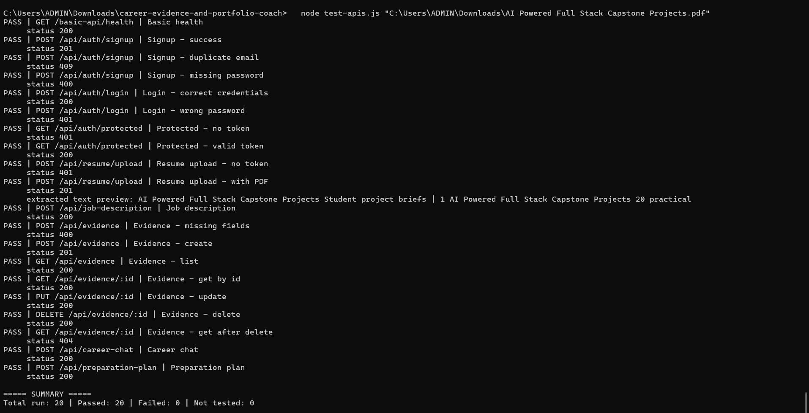
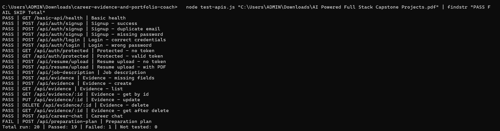
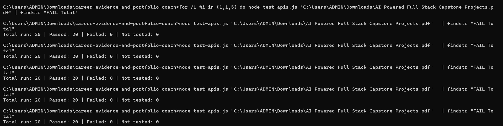
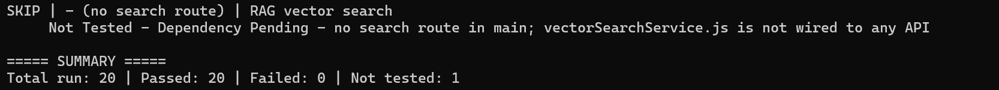
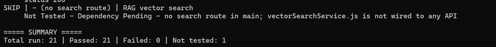
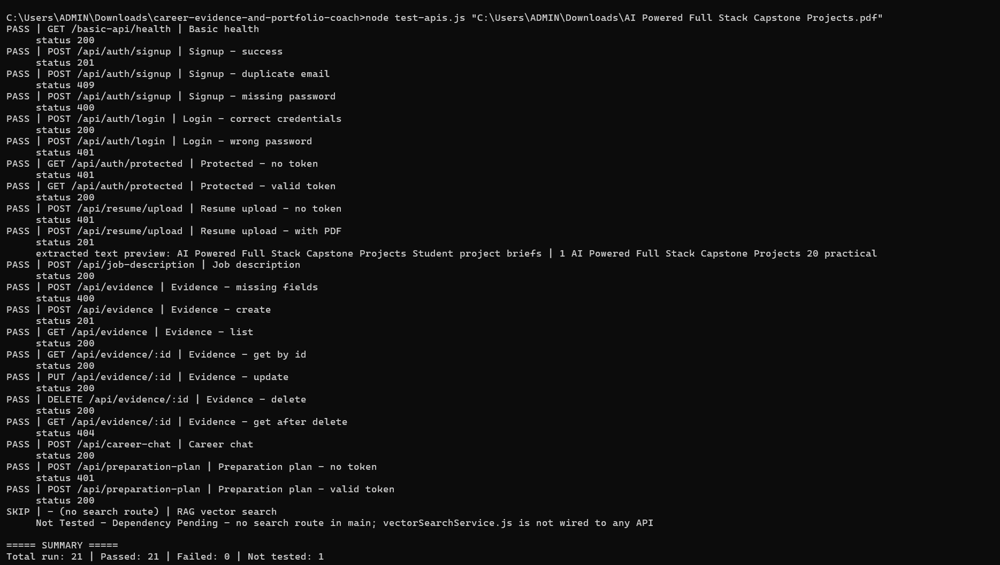
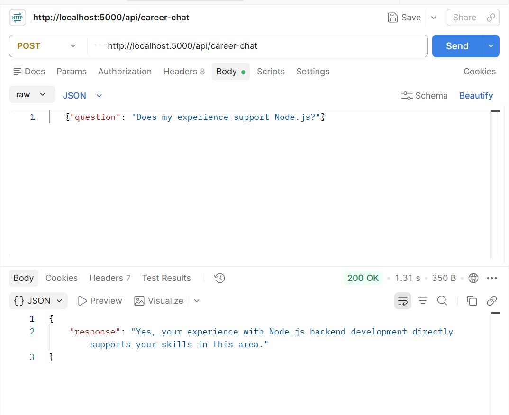
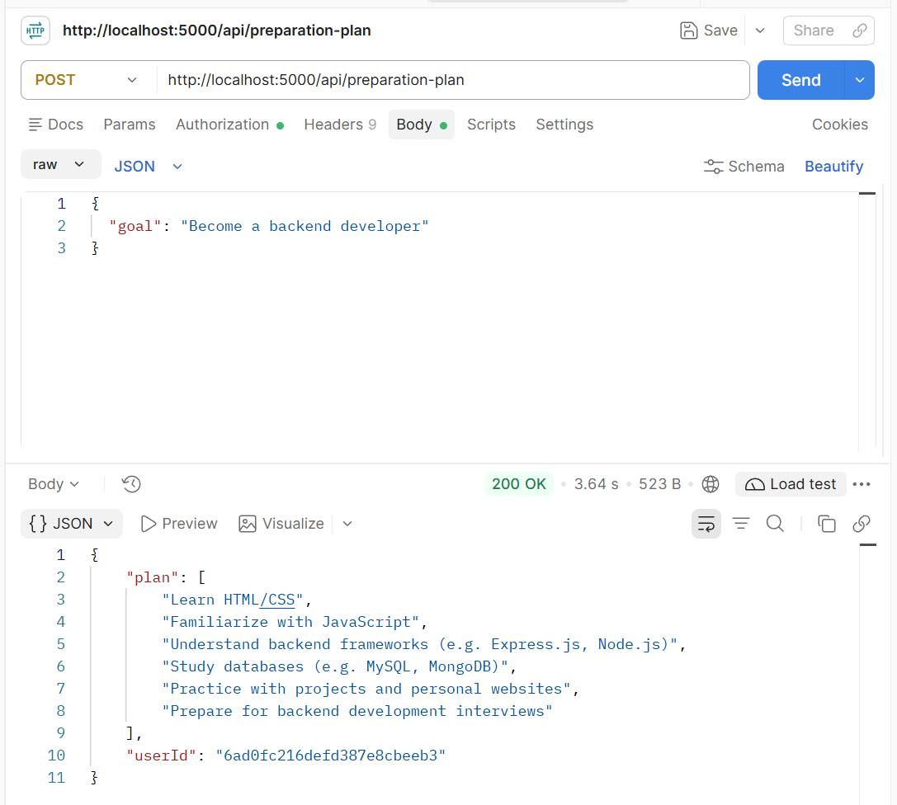
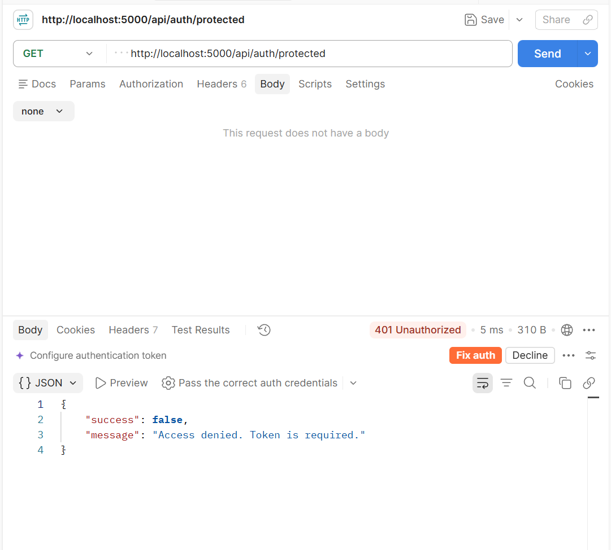
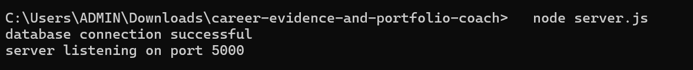

# API Test Report

- **Project:** Career Evidence and Portfolio Coach
- **Tester:** Member 63
- **Date:** 10 October 2026 (first test runs), 11 October 2026 (retest after Member 62's fix), 15 October 2026 (rerun after the JWT change)
- **Code tested:** latest `main` branch of the team repository. The retest includes Member 62's fix (pull request #7). The 15 October run also includes Member 62's JWT change, which is now merged into `main`.
- **Environment:** server running locally at `http://localhost:5000`, connected to the team's MongoDB Atlas database
- **How it was run:** `node test-apis.js "<path to a sample PDF>"`

## Summary

| Measure | Count |
|---|---|
| Tests per run | 20 |
| Main run before the fix: passed | 20 of 20 |
| Another run before the fix: passed | 19 of 20 (1 failure, Preparation Plan) |
| Retest after Member 62's fix: number of runs | 5 |
| Retest after the fix: passed in each run | 20 of 20 |
| Retest after the fix: failed | 0 |
| Not tested | 1 (RAG vector search, Dependency Pending) |
| Latest run after the JWT change (21 tests) | 21 passed, 0 failed, 1 not tested |
| Latest run after merging the latest `main` on 19 October (Evidence and Career Chat need a token) | 21 passed, 0 failed, 1 not tested |

One run before the fix gave 19 passed and 1 failed. The failure was **Preparation Plan** (`500`, "Failed to generate plan"). The server log for that run showed `AI error: Unexpected end of JSON input`. The same API passed in the other runs, so it was intermittent. Member 62 then merged a fix, and after pulling it and restarting the server, all 5 retest runs passed. See "Bugs Discovered".

Career Chat and Preparation Plan need a local Ollama instance running the `llama3.2` model (both APIs call `http://localhost:11434/api/generate`). On the first runs, before Ollama was installed on the tester's machine, both returned `500` (server log: `AI error: fetch failed`). After installing Ollama and the `llama3.2` model, both passed.

The script checks the status code and that a response body is present (for Career Chat, that `response` is a non-empty text). It does not judge the quality of the AI answers. See the Postman screenshots for actual response content.

## Results

| API | Method | Expected Result | Actual Result | Status |
|---|---|---|---|---|
| Basic health, `/basic-api/health` | GET | Successful response | 200 | Pass |
| Signup, `/api/auth/signup` | POST | Account created | 201 | Pass |
| Signup, duplicate email | POST | 400 or 409 | 409 | Pass |
| Signup, missing password | POST | 400 | 400 | Pass |
| Login, correct credentials, `/api/auth/login` | POST | Token returned | 200 with token | Pass |
| Login, wrong password | POST | 401 | 401 | Pass |
| Protected route, no token, `/api/auth/protected` | GET | 401 | 401 | Pass |
| Protected route, valid token | GET | 200 | 200 | Pass |
| Resume upload, no token, `/api/resume/upload` | POST | 401 | 401 | Pass |
| Resume upload, with PDF | POST | PDF text extracted | 201, extracted text present ("AI Powered Full Stack Capstone Projects...") | Pass |
| Job description, `/api/job-description` | POST | Accepted with a response | 200 | Pass |
| Evidence, missing fields, `/api/evidence` (with Bearer token) | POST | 400 | 400 | Pass |
| Evidence, create (with Bearer token) | POST | Record created with an id | 201 with id | Pass |
| Evidence, list | GET | New record appears in the list | 200, record present | Pass |
| Evidence, get by id | GET | Same record returned | 200, same id | Pass |
| Evidence, update | PUT | Updated title returned | 200, title updated | Pass |
| Evidence, delete | DELETE | Record deleted | 200 | Pass |
| Evidence, get after delete | GET | 404 | 404 | Pass |
| Career Chat, `/api/career-chat` (with Bearer token) | POST | Answer returned | 200 with a text response (local Ollama, `llama3.2`) | Pass |
| Preparation Plan, `/api/preparation-plan` (no token) | POST | 401 Unauthorized | 401 (route is now protected by JWT after Member 62's change) | Pass |
| Preparation Plan, `/api/preparation-plan` (valid Bearer token) | POST | Plan returned | 200 with a plan. One 500 before PR #7; 5 of 5 retest runs passed after it; passes with a token after the JWT change | Pass (retested after fix and JWT) |

## APIs Not Tested and Why

| API | Owner | Reason |
|---|---|---|
| RAG vector search | Member 58 | Not Tested - Dependency Pending. No search route exists in `main`: `searchRelevantChunks()` in `vectorSearchService.js` is not called by any API, so there is nothing to call. Member 58 confirmed search is a service function only (tested separately with `node testSearch.js`) and that the Atlas index `rag_vector_index` exists on `evidencechunks`; the Career Chat integration is on their branch, not yet in `main`. RAG indexing is covered indirectly, since resume upload calls it and returns 201. |

MongoDB connectivity (Member 5) was confirmed indirectly: the server connected to Atlas and all database tests above passed.

## Bugs Discovered

**Member 62 (Preparation Plan), fixed:** before the fix, one run returned `500` "Failed to generate plan" and the server log showed `AI error: Unexpected end of JSON input`. It passed in the other runs. Member 62 merged a fix (pull request #7, "Retry and validate AI response in preparation plan API"). After pulling it and restarting the server, the script was run 5 times in a row and Preparation Plan passed every time. Five clean runs make it likely fixed, but because the problem was intermittent they do not prove it.

No other confirmed bugs in the APIs that could be tested.

Minor notes:

- **Member 51 (Evidence):** the server warns that the update code uses a deprecated Mongoose option (`new`). It still works. Suggested fix: use `returnDocument: 'after'`.
- **Member 35 (Resume):** on the latest `main` the upload returns `201` with the details inside a `resume` object, while the earlier branch screenshot showed `200` with `text` at the top level. Worth confirming this is the intended final response.
- **Member 59 (Career Chat):** the answer to "Does my experience support Node.js?" was generic and did not mention any specific stored evidence. The API works, but it was not shown to ground its answer in saved evidence.
- **Member 58 (RAG):** `resume-api.js` calls `indexText` after `Resume.create`, inside the same try block. If indexing fails, the user gets a `500` even though the resume is already saved. Also, the upload response does not mention chunks, so the API alone cannot prove chunks were stored. The Atlas `$vectorSearch` index on the chunks collection could not be checked, so its existence could not be verified; Member 58 says it is named rag_vector_index.
- **Member 62 (Preparation Plan):** when it worked, it returned a six-step plan for the goal "Become a backend developer".

## Notes on Test Data

Each run creates one test user (`apitest_<number>@test.com`) in the shared database. The evidence test creates a record and deletes it again. Test users can be removed by Member 5.

## Screenshots

**1. Test script running in the terminal (PASS/FAIL lines and summary)**

Main run before the fix, 20 passed:

Another run before the fix, where Preparation Plan failed once (19 passed, 1 failed):

Retest after Member 62's fix, 5 runs, 20 of 20 passed each time:

Run after the RAG skip was added (20 passed, 0 failed, 1 not tested; RAG vector search marked Not Tested - Dependency Pending):

Latest run after Member 62's JWT change (21 tests; Preparation Plan with no token gives 401, with a valid token gives 200):

Latest run on the updated `main` (19 October; 21 tests, Evidence and Career Chat sent with a Bearer token):

**2. Successful API responses in Postman**

Career Chat (`POST /api/career-chat`, 200 OK):

Preparation Plan (`POST /api/preparation-plan`, 200 OK):

**3. Unauthorized response (protected route without a token)**

**4. Server running and connected to the database**

## Unresolved Issues and Dependencies

- RAG vector search has no API route in `main` yet (Member 58), so it is marked Not Tested - Dependency Pending. Member 58 says search is a service function (`searchRelevantChunks()`), integrated with Career Chat only on their branch, and that the Atlas index `rag_vector_index` exists on `evidencechunks`. This was reported by Member 58 and was not verified through the API. Retest once their branch is merged. On 19 October I also checked the branch `origin/features/rag-services`: `searchRelevantChunks()` is still only defined in `vectorSearchService.js`, with no route calling it, and `testSearch.js` was not on that branch.
- After merging the latest `main` on 19 October, Evidence and Career Chat now require a Bearer token (`401 "Access denied. Token is required."` without one). The first rerun showed 3 to 4 failures because `test-apis.js` sent no token on those routes; this was a test-script gap, not an API bug. The script now sends the login token on them, and the full suite passes again. Anyone calling these APIs must send a token.
- Career Chat and Preparation Plan only work on a machine that has Ollama running with `llama3.2`. Team members testing them need the same setup.
- Preparation Plan was fixed by Member 62 after an intermittent failure, and Member 62's JWT change (now merged into `main`) made the route require a Bearer token. Both were retested on 15 October: no token gives 401, a valid token gives 200. It is still worth watching in later runs because the original failure was intermittent.